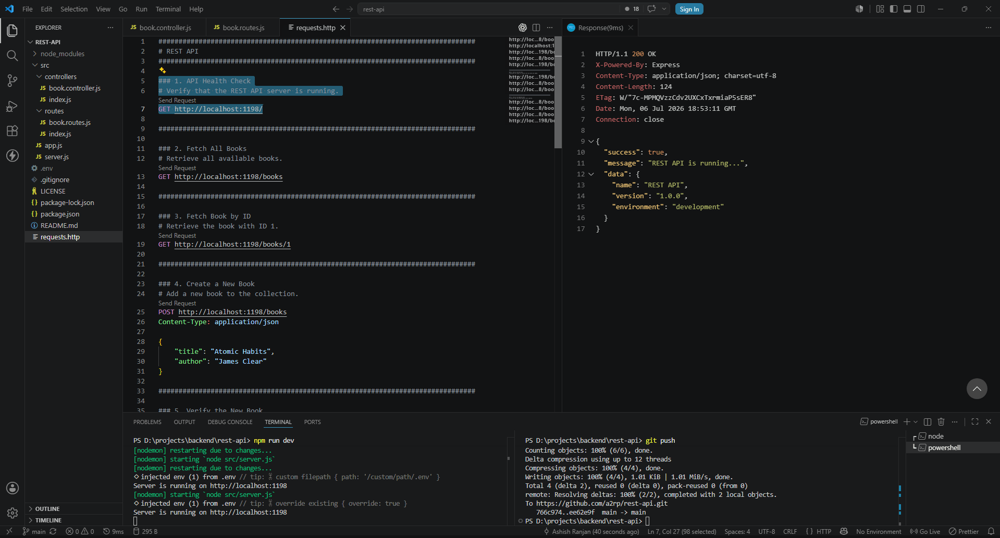

# REST API

A focused backend project demonstrating REST API fundamentals using Node.js and Express.



## Tech Stack

- Node.js
- Express.js

## Getting Started

```bash
npm install
npm run dev
```

## Development

Development Port: **1198**

Base URL: `http://localhost:1198`

## API Endpoints

| Method | Endpoint     | Description             |
| ------ | ------------ | ----------------------- |
| GET    | `/books`     | Fetch all books         |
| GET    | `/books/:id` | Fetch a single book     |
| POST   | `/books`     | Create a new book       |
| PUT    | `/books/:id` | Update an existing book |
| DELETE | `/books/:id` | Delete an existing book |

## API Testing

Use the included `requests.http` file to test all API endpoints directly from VS Code with the REST Client extension.

## License

MIT

## Support

If you find this project helpful, consider supporting my work:

❤️ [Support My Work](https://a2rp-donation-page.netlify.app/)

## Connect with Me

- 🌐 Portfolio: <https://www.ashishranjan.net>
- 💻 GitHub: <https://github.com/a2rp>
- ✒️ CodePen: <https://codepen.io/ash1198>
- 💼 LinkedIn: <https://www.linkedin.com/in/aashishranjan>
- 📘 Facebook: <https://www.facebook.com/theash.ashish/>
- ▶️ YouTube: <https://www.youtube.com/@ashishranjan-ashz>
